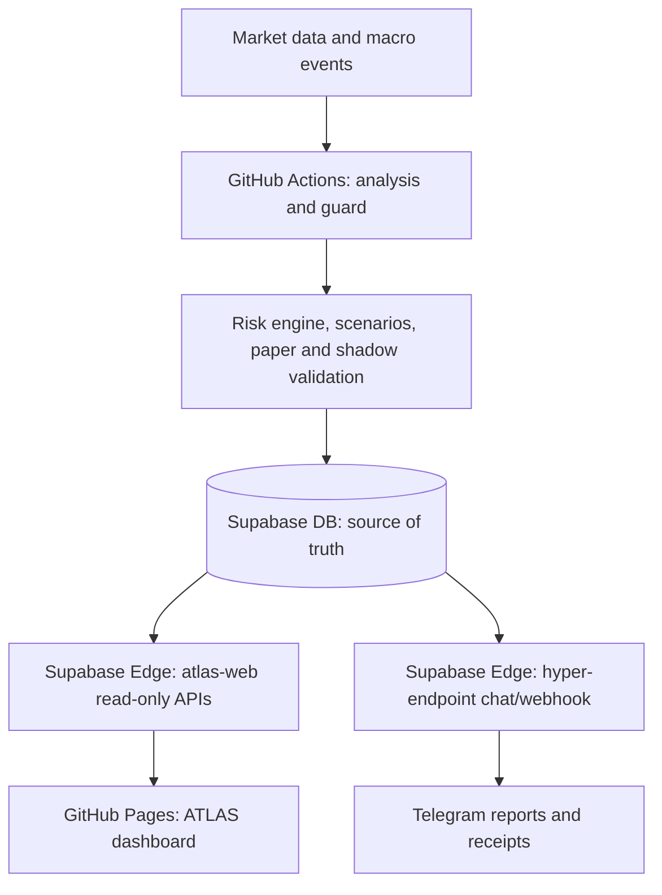

# ATLAS AI — Risk-First Quant Research & Market Intelligence

**ATLAS AI** is a research-first platform for **crypto, Iranian markets, metals and cross-market risk**. It collects market observations, performs quantitative screening and risk analysis, archives evidence, and presents read-only dashboards and Telegram reports. Its goal is to **expose risk and missing data before encouraging action**, not to sell guaranteed trading signals.

> **Research / Paper Only. Not financial advice.** Do not interpret a score, scenario, dashboard status, or historical simulation as a verified profitable strategy or an order to trade. Live trading is disabled in the referenced GitHub Actions workflow.

## Capabilities and status

| Area | What is present | Important qualification |
| --- | --- | --- |
| Crypto spot | CoinGecko-sourced market snapshots, cached in Supabase | Quotes require positive price, provenance and freshness checks. Binance is a comparison/fallback source, not a substitute for CoinGecko attribution. |
| Futures & derivatives | Risk scenarios, cost modeling, market structure and separate derivatives widgets | An OKX observation is **not** a CoinGlass aggregate. No undocumented data synthesis. |
| Iran & metals | TSE, funds, FX, gold, silver, copper and relative-value views | Currency units and quote dates must be explicit; invalid inputs block valuation. |
| Early-warning & radar | Persisted warnings, audit trails and risk flags | A recorded alert is not proof of predictive accuracy. Track lead time, false positives and delivery receipts. |
| Validation | Unit tests, backtest scripts, walk-forward/shadow research components | **No OOS performance number is claimed here** without a reproducible evidence artifact. |
| Delivery | GitHub Actions analysis, Supabase database/API, Telegram webhook, static dashboard | The Analysis Plane must not poll Telegram inbox. |

## System architecture



**Separation of responsibilities:** GitHub is the **Analysis Plane**; Supabase DB is the **source of truth**; Supabase Edge Functions/Webhooks form the **Chat Plane**; GitHub Pages is a static presentation layer. Telegram replies belong to Supabase, not scheduled GitHub polling.

## Project map

- `.github/workflows/atlas.yml` — scheduled and manually dispatched ATLAS cycles
- `atlas_schedule_guard.py` — Tehran-based scheduling and slot deduplication
- `bot.py` — analysis/report integration (large legacy entrypoint; avoid unreviewed moves)
- `atlas_futures_backtest_18m.py`, `atlas_futures_costs.py` — historical research and modeled costs
- `test_atlas_*.py` — component safety and regression tests
- `supabase/functions/atlas-web/index.ts` — public read-only API and hosted application
- `atlas-dashboard.html`, `assets/` — static dashboard and widgets
- `docs/ARCHITECTURE.md` — deployment boundaries, status, source provenance, risks

## Local verification

Requires Python 3.11 or newer. Install requirements, then run the non-live safety suite:

```bash
python -m pip install -r requirements.txt
python -m unittest -v test_atlas_futures_png.py test_atlas_scheduler_safety.py test_atlas_telegram_receipts.py
python -m py_compile bot.py atlas_schedule_guard.py atlas_futures_backtest_18m.py atlas_futures_costs.py
```

**Do not run** `bot.py` as a live process without reviewing environment variables, secrets, delivery permissions and the paper-only gates. Manual GitHub workflow dispatch is configured for storage-only diagnostics.

## Research evidence

Any 18-month backtest result must link a commit, immutable dataset/window, market venue, fees, slippage, funding, walk-forward/OOS split, drawdown, exposure and repeatable artifacts. The `atlas_futures_costs.py` module models *scenario* costs, not actual execution fills. Until evidence is linked and reviewed, win rate, Sharpe and net return are **unverified**.

| Experiment | Dataset / period | Fees + funding + slippage | OOS net result | Evidence |
| --- | --- | --- | --- | --- |
| 18-month futures research | Not independently verified for release | Model implemented; artifacts required | **Not established** | Add immutable run and review |
| Shadow / walk-forward | Research components exist | Verify per-run configuration | **Not established** | Add versioned run and review |

## Source transparency

The read-only `/api/live-terminal` endpoint now combines **CoinGecko-tagged stored spot quotes** with separately labeled hourly `TOP10` / `PERSONAL` cache fallbacks. Metals are filtered out of crypto market coverage. Every displayed price must keep its timestamp and provenance; a delayed or unverified upstream is not a live quote. Derivatives data are shown separately.

## Security and licensing

Never commit tokens, Supabase service-role keys or Telegram secrets. Public clients can use a publishable key only where applicable; privileged queries remain inside controlled Edge Functions. Supabase tables exposed through the API require appropriate RLS. **No open-source license is declared** unless the repository owner explicitly chooses one; public visibility alone is not a license to reuse.

For the detailed system contract and outstanding engineering issues, see [Architecture](docs/ARCHITECTURE.md). A Persian development note remains in [README_FA.md](README_FA.md).
